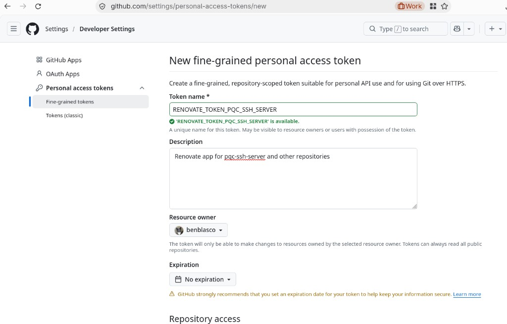
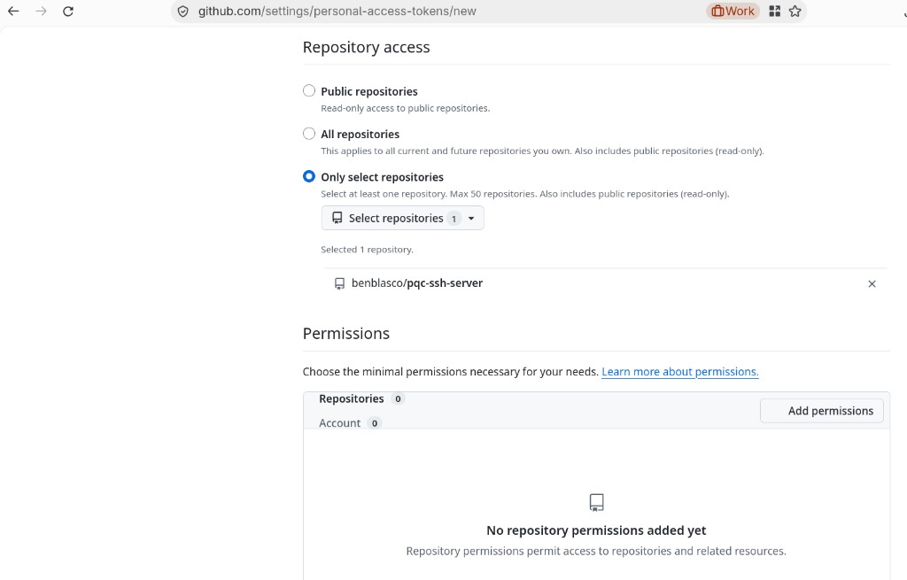
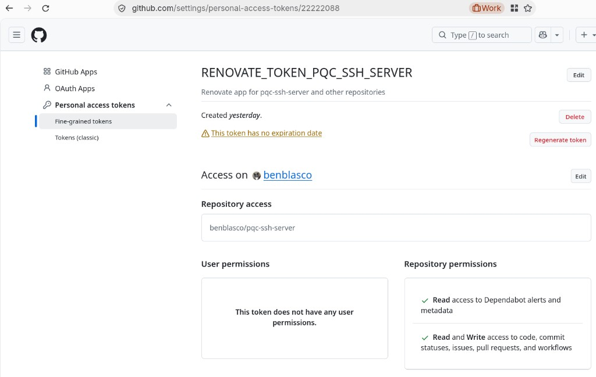
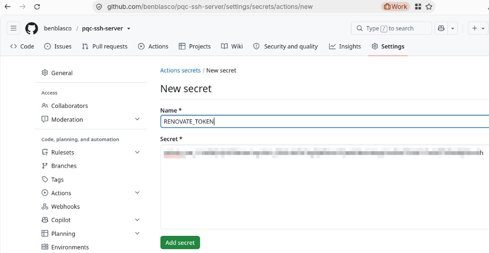

# pqc-ssh-server
Post-quantum capable SSH server container

## Development

Git commits run [pre-commit](https://pre-commit.com/) hooks (YAML, Forgejo Actions via actionlint, Containerfile
via hadolint, gitleaks, shellcheck, markdown). **No `dnf install`** — tools use `pip install --user` and
pre-commit’s cache under `~/.cache/pre-commit/`.

```bash
python3 -m pip install --user -r requirements-dev.txt
export PATH="$HOME/.local/bin:$PATH"   # add to shell profile if needed
pre-commit install
pre-commit run --all-files             # first-time / CI-style check
```

Verify: `pre-commit --version`, `command -v pre-commit`.

Lint config: [`.yamllint.yml`](.yamllint.yml) (120 columns, comment spacing),
[`.markdownlint-cli2.yaml`](.markdownlint-cli2.yaml) (MD013 on prose, 120 columns). **MD031** / **MD040** require
blank lines around fenced blocks and a language tag on each fence. [`.github/actionlint.yaml`](.github/actionlint.yaml)
registers the `pqc-ssh-server` runner label. Hadolint runs via Podman ([`.pre-commit/run-hadolint.sh`](.pre-commit/run-hadolint.sh);
ignores **DL3007** / **DL3041**).

## CI (Forgejo Actions)

Build and push to `micro.lan:5000` and `nuc.lan:5000` via
[`.forgejo/workflows/container-build.yml`](.forgejo/workflows/container-build.yml). Runner label **`pqc-ssh-server`**
and one-time setup in [podman-container-yaml](https://github.com/benblasco/podman-container-yaml) are documented in
[README.forgejo-actions.md](README.forgejo-actions.md). Signal notifications:
[README.forgejo-notification.md](README.forgejo-notification.md).

## Run

Build (default `sshuser` UID/GID **1000**; override if your login user is different):

```bash
podman build -t pqc-ssh-server -f Containerfile \
  --build-arg SSH_UID="$(id -u)" --build-arg SSH_GID="$(id -g)" .
```

Generate an Ed25519 key pair on the client (skip if you already have one):

```bash
ssh-keygen -t ed25519 -f "${HOME}/.ssh/id_ed25519" -C "$(whoami)@$(hostname -f)"
```

Keep a copy of your **Ed25519 public** key on the host (used when loading the volume below):

```bash
install -d -m 700 "${HOME}/.config/pqc-ssh-server"
cp "${HOME}/.ssh/id_ed25519.pub" "${HOME}/.config/pqc-ssh-server/authorized_keys"
chmod 600 "${HOME}/.config/pqc-ssh-server/authorized_keys"
```

### Volumes

Create two named volumes:

- **`pqc-ssh-hostkeys`** — persists the **server host** Ed25519 key under `/var/lib/sshd`.
- **`pqc-ssh-authorized-keys`** — holds `sshuser`’s **`authorized_keys`** (must be owned **`sshuser:sshuser`**
  inside the container, mode **`600`**).

```bash
podman volume create pqc-ssh-hostkeys
podman volume create pqc-ssh-authorized-keys
```

Load (or update) the client public key into the authorized-keys volume. Use **`--entrypoint sh`** so the image
entrypoint does not start `sshd`. Pipe the key in stdin so you do not bind-mount the host file (rootless Podman often
blocks that read inside the init container):

```bash
cat "${HOME}/.config/pqc-ssh-server/authorized_keys" | podman run -i --rm --entrypoint sh \
  -v pqc-ssh-authorized-keys:/home/sshuser/.ssh \
  pqc-ssh-server \
  -c 'cat > /home/sshuser/.ssh/authorized_keys \
      && chown '"$(id -u)"':'"$(id -g)"' /home/sshuser/.ssh/authorized_keys \
      && chmod 700 /home/sshuser/.ssh \
      && chmod 600 /home/sshuser/.ssh/authorized_keys'
```

Use the same **`SSH_UID` / `SSH_GID`** you passed at build time in the `chown` ( **`$(id -u)` / `$(id -g)`** when
you built as your login user).

### Start the container (rootless Podman)

Default user namespace mapping only — do **not** use **`--userns=keep-id`** or **`--user`** for this image (see
[Rootless Podman notes](#rootless-podman-notes)).

```bash
podman run -d --rm --replace \
  -p 22222:22 \
  -v pqc-ssh-hostkeys:/var/lib/sshd:Z \
  -v pqc-ssh-authorized-keys:/home/sshuser/.ssh:ro,Z \
  --name pqc-ssh-server \
  pqc-ssh-server
```

**`--replace`** recreates the container if that name is already in use (including while it is still running).
**`--rm`** removes the container when it exits so stopped instances do not accumulate.

Connect (from the host or another machine; open **TCP 22222** on the host firewall if needed):

```bash
ssh -p 22222 -i "${HOME}/.ssh/id_ed25519" sshuser@localhost
# ssh -p 22222 -i "${HOME}/.ssh/id_ed25519" sshuser@nuc.lan
```

After changing keys in the volume, restart the container: `podman restart pqc-ssh-server`.

### Rootless Podman notes

**Why a named volume for client keys?** With default rootless mapping, bind-mounting a host `authorized_keys` file
into `/home/sshuser/.ssh/authorized_keys` often appears as **`root:root` mode `600`** inside the container. OpenSSH
opens that file as **`sshuser`** with **`StrictModes yes`**, so login fails with **`Permission denied (publickey)`**
even when the key content is correct. A named volume populated with **`chown`** to **`sshuser`** avoids that.

**Do not use `--userns=keep-id` or `--user 1000:1000`.** `sshd` must run as **root** in the container (read
**`/etc/ssh/sshd_config`**, bind port 22, manage host keys). Keep-id runs the process as your host UID; the container
then exits with **`/etc/ssh/sshd_config: Permission denied`** and nothing listens on the published port.

**Build-time UID/GID** still matters: **`sshuser`** in the image must match the numeric owner you use when
**`chown`**ing `authorized_keys` in the volume.

**Verify on the host before testing SSH:**

```bash
podman ps --filter name=pqc-ssh-server
podman exec -u sshuser pqc-ssh-server test -r /home/sshuser/.ssh/authorized_keys && echo OK
ss -tlnp | grep 22222
getenforce
```

## Image size

The `Containerfile` installs `openssh-server` with **`install_weak_deps=0`** and **`tsflags=nodocs`**, so weak
recommendations (extra systemd units, D-Bus, `cracklib-dicts`, and similar) are not pulled in. Remaining
`/usr/share/doc` and `/usr/share/info` trees are removed after install. Hard dependencies required for `sshd`, PAM,
and crypto-policy stay installed.

## Intrusion blocking (fail2ban / sshguard)

This image **does not** ship **fail2ban** or **sshguard**. Public-key-only login already removes password brute
force; either tool would mainly react to **failed key attempts**, invalid users, and scanner noise by **banning source
IPs** (usually via nftables/iptables inside the container, often requiring **`--cap-add=NET_ADMIN`** on Podman and an
auth log source such as **rsyslog** writing to `/var/log/secure`).

| Tool | Notes |
|------|--------|
| **fail2ban** | Flexible jails; common on Fedora hosts; heavier in a minimal container (Python, jail/filter setup). |
| **sshguard** | Small C daemon focused on log-driven blocks; often simpler for **SSH-only** containers. |

For many deployments here, **network controls** (do not expose SSH broadly, VPN/bastion, host or edge firewall
allowlists) matter more than in-container jails. Consider adding one of these tools if the service is
**internet-facing** and you want automatic throttling of repeated failures; skip them if SSH is **LAN/VPN-only** and
you prefer a minimal image.

## Dependency updates (Renovate)

Dependency bumps are handled on **GitHub**, not Forgejo. This repository’s **source of truth is GitHub** (`main`);
Forgejo is a **read-only pull mirror** used to run homelab **build** Actions only (see
[README.forgejo-actions.md](README.forgejo-actions.md)). Renovate does not support running against Forgejo **pull
mirror** repositories, so the bot is wired on GitHub instead.

| File | Role |
|------|------|
| [`.github/workflows/renovate.yml`](.github/workflows/renovate.yml) | Scheduled GitHub Actions workflow (GitHub-hosted `ubuntu-latest`, **24h before** the Forgejo container build) that runs Renovate with the `RENOVATE_TOKEN` secret. |
| [`.github/renovate.json`](.github/renovate.json) | Renovate config: dev Python deps, pre-commit hook tags, `Containerfile` base image, Hadolint image in [`.pre-commit/run-hadolint.sh`](.pre-commit/run-hadolint.sh), and action pins in [`.forgejo/workflows/container-build.yml`](.forgejo/workflows/container-build.yml). |

Merge Renovate PRs on GitHub; the Forgejo mirror picks up the changes on the next sync.

### One-time setup: fine-grained PAT and `RENOVATE_TOKEN`

The scheduled workflow in [`.github/workflows/renovate.yml`](.github/workflows/renovate.yml) reads
**`secrets.RENOVATE_TOKEN`**. That value must be a GitHub fine-grained personal access token (PAT); see [Managing
personal access tokens][github-pat-docs] (**Fine-grained tokens**). Renovate needs repository access to open and
update pull requests. Store the PAT only as the repository secret; never commit it.

1. **Create the PAT** — GitHub **Settings → Developer settings → Personal access tokens → Fine-grained tokens →
   Generate new token**. Pick a clear token name, optional description, resource owner, and expiration (GitHub
   recommends an expiry; “No expiration” is shown below for a homelab token you rotate manually).

   

2. **Scope repositories** — Under **Repository access**, choose **Only select repositories** and add
   **`benblasco/pqc-ssh-server`** (add other repos to the same token if one Renovate run should manage them).

   

3. **Repository permissions** — Under **Repository permissions**, grant the access [Renovate documents for fine-grained tokens](https://docs.renovatebot.com/modules/platform/github/). Leave **User permissions** empty. GitHub labels **Contents** as “code” in the UI.

   | Permission (GitHub UI) | Access | Used for |
   | --- | --- | --- |
   | **Contents** (code) | Read and write | Branches and commits for update PRs |
   | **Pull requests** | Read and write | Open and update Renovate PRs |
   | **Issues** | Read and write | Dependency dashboard issue (`config:recommended`) |
   | **Workflows** | Read and write | Action pin bumps in `.github/workflows/` and `.forgejo/workflows/` |
   | **Commit statuses** | Read and write | Status checks on Renovate branches when enabled |
   | **Dependabot alerts** | Read-only | Security context for dependency updates |
   | **Metadata** | Read-only (automatic) | Repository discovery and API metadata |

   

4. **Generate the token** — Copy the PAT once; GitHub will not show it again.

5. **Add the Actions secret** — In the repo on GitHub: **Settings → Secrets and variables → Actions → New repository
   secret**. Name **`RENOVATE_TOKEN`**, paste the PAT, then **Add secret**.

   

6. **Verify** — **Actions → Renovate → Run workflow** (workflow_dispatch). A successful run confirms the secret and
   PAT permissions.

Verification (local): `test -f docs/images/renovate/04-fine-grained-pat-repository-permissions.png && echo OK`

## References

[github-pat-docs]: https://docs.github.com/en/authentication/keeping-your-account-and-data-secure/managing-your-personal-access-tokens

- [SSH Post-Quantum Cryptography Configuration Guide](https://gist.github.com/michabbb/5eb580d60ede01dc7d1e5abc72d7eb40)
